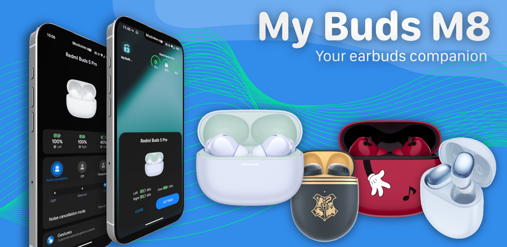

# My Buds M8 Resources

<dl><dd></dd></dl>

## Contents
- Earbuds firmware files.
- Earbuds models information.
- My Buds M8 application translation files.

## Download

<!--a href="https://play.google.com/store/apps/details?id=bz.zaa.mibudsm8"></a-->
<!--a href="https://appgallery.huawei.com/app/C106054801"></a-->
Discussion and app beta version: [Telegram](https://t.me/mibudsm8).

## Disclaimer

My Buds M8 is an independent third-party tool developed by a sole developer and is not affiliated with, endorsed by, or sponsored by Xiaomi Inc., Redmi, or POCO. All product names, trademarks, and registered trademarks belong to their respective owners.

## Copyright
My Buds M8 © 2016-2026 [**zaa.bz**](https://zaa.bz/mibudsm8)

Redmi™, POCO™, mi™ and Xiaomi™ are trademarks of their respective owners.

Images and firmware files are gathered from various open sources, or shared by users.
